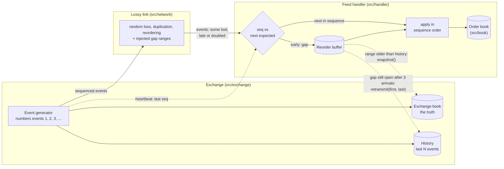
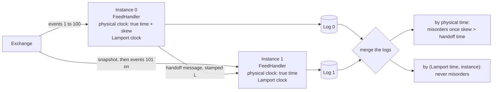
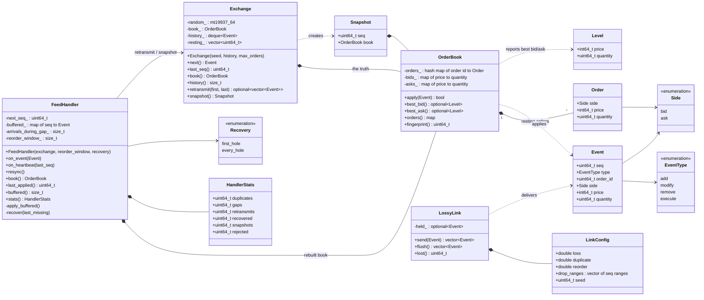
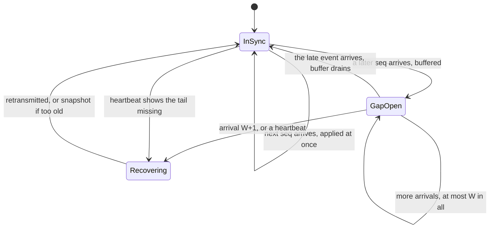
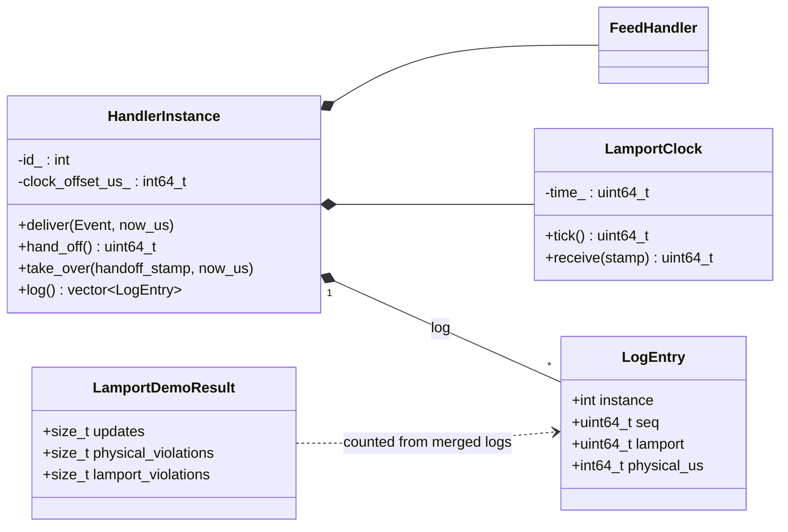
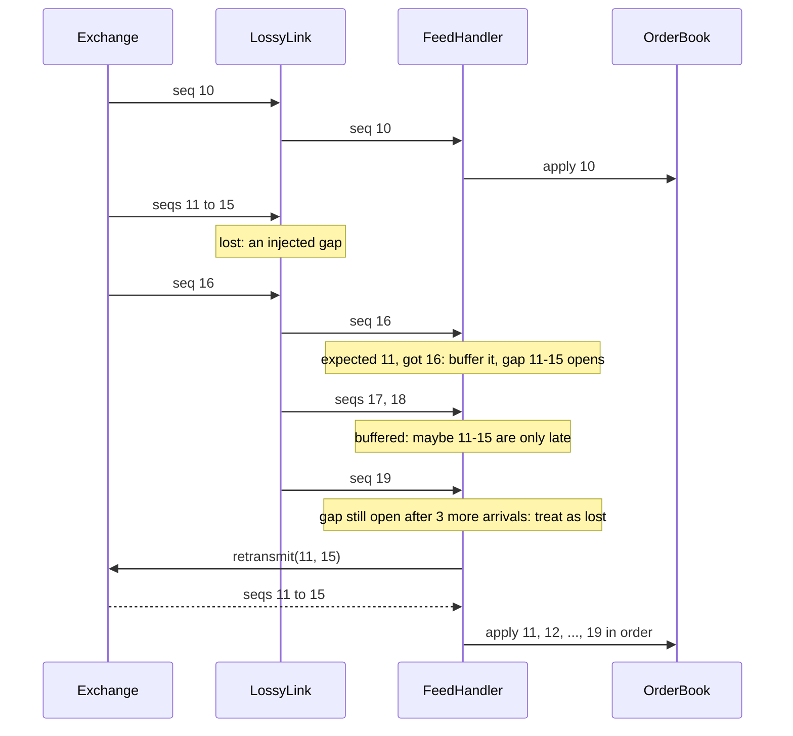
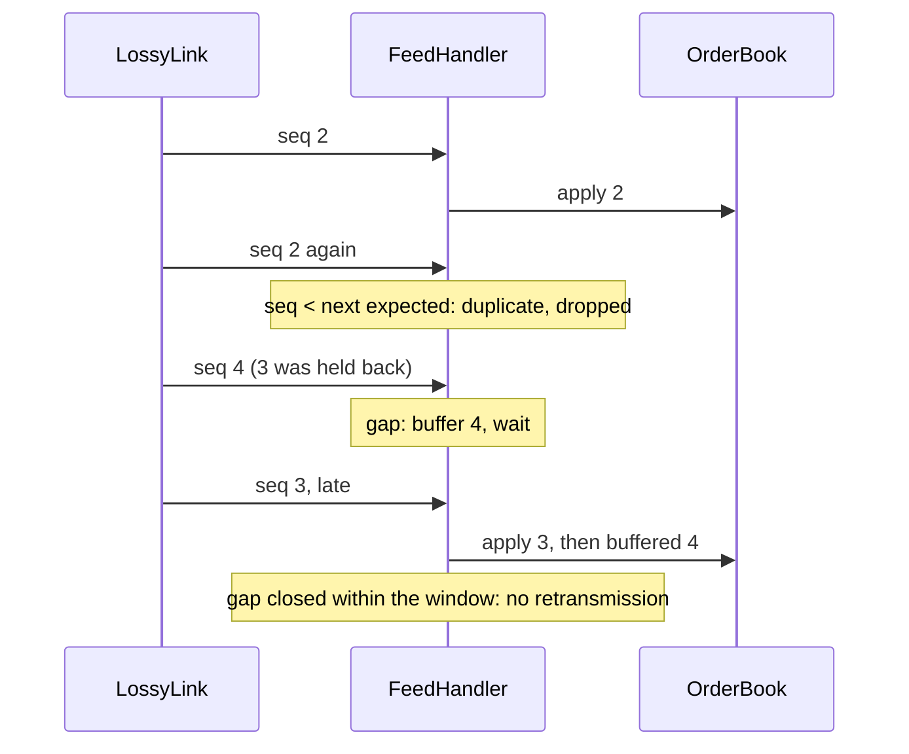
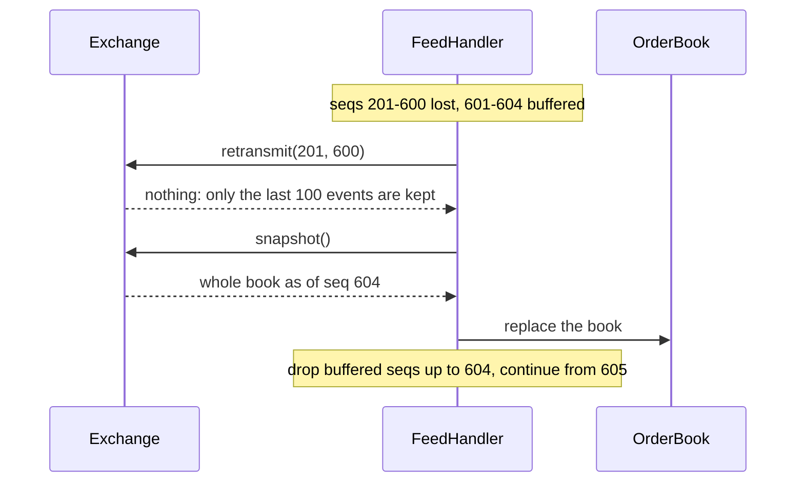
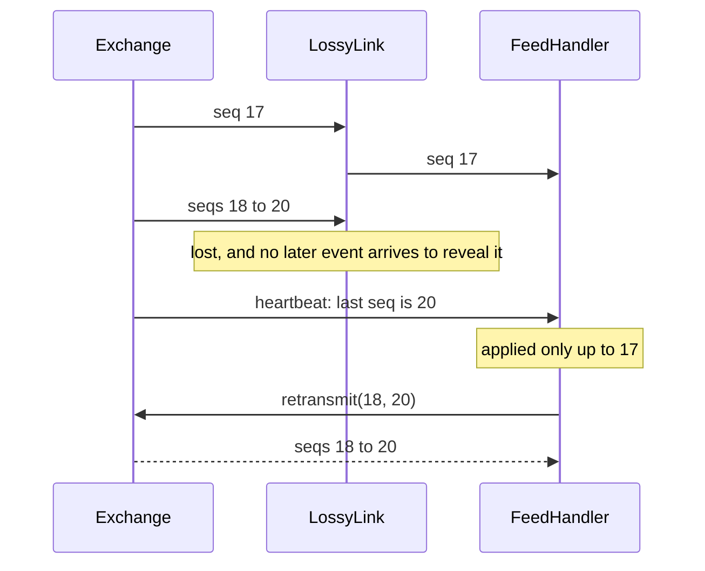
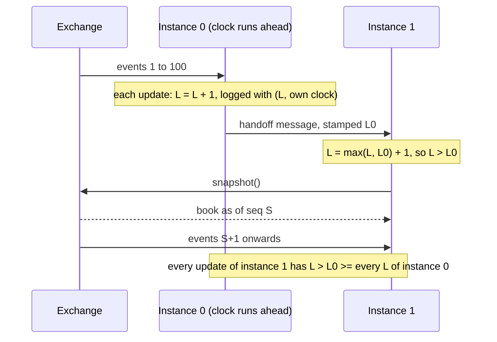

# A market data feed handler that never shows a wrong book

An exchange publishes every change to its order book as a numbered event. On the way to a trading
system some events are lost, some arrive twice and some arrive out of order. **This feed handler** rebuilds the
exchange's order book from that damaged stream, exactly: it detects every gap, tells a late event from
a lost one, and recovers lost events by retransmission or, when they are too old, by a snapshot.

It was built for Programming Assignment 1 of the Distributed Computing elective at IIIT Bangalore
(the HFT lecture series), which asks for a handler that

1. **consumes a sequenced event stream**: the exchange numbers every event 1, 2, 3, ...;
2. **reconstructs the order book** from those events;
3. **detects and recovers from artificially injected gaps**: events lost, duplicated or reordered on the way;
4. and encourages **Lamport timestamps** once there are several independently clocked handler instances.

This project does all four in one small C++20 program, entirely in one process. The "network" is a
simulated lossy link, and recovery requests are function calls to the exchange. Every run is seeded,
so every result can be reproduced exactly, on any machine.

## What this is, in plain words

A stock exchange keeps a list of everyone who wants to buy or sell, and at what price. That list is
the **order book**. Each time someone places, changes, cancels or fills an order, the book changes,
and the exchange broadcasts the change as a short numbered message: change 1, change 2, change 3, and
so on. Banks, brokers and trading firms keep their own copy of the book by applying these changes in
order as they arrive. The stream of changes is a **market data feed**; the program that turns it back
into a book is a **feed handler**.

The feed travels over a network that is fast but careless. Some messages never arrive, some arrive
twice, and some arrive after the one that should have followed them. A handler that simply applied
whatever came in would soon hold a book different from the exchange's, and nothing in it would say so.

This feed handler never lets that happen. It notices a missing number, waits a moment in case the message is
only late, and if it really is lost, asks the exchange to send it again. If the exchange no longer has
it, the handler asks for a copy of the whole book instead. Its copy is never wrong: at worst it is a few
messages behind, and it always catches up.

Think of a novel delivered one numbered page at a time by a careless postman. You never read page 12
before page 11. If page 11 is missing, you wait for a delivery or two in case it turns up; if it does
not, you ask the publisher for page 11; and if the publisher has thrown its old pages away, you ask for
the whole book so far. You may be a little behind, but you are never reading the wrong story.

## Why anyone should care

- **Money moves on the book.** Trading systems decide what to buy and sell from their copy of it. A copy
  that silently differs from the exchange's means orders at prices that are not there: losses, and
  trades that are hard to explain afterwards.
- **The same problem is everywhere.** Anything that keeps a copy of data by replaying a stream of
  changes has it: a database replica following its primary, a shared document, a multiplayer game, a
  phone syncing messages. Sequence numbers, a reorder buffer, retransmission and snapshots are the
  standard answer; this project shows each one working, and measures what it costs.
- **"It seems to work" is not enough.** A handler can look right for hours and still be wrong for a
  moment, which is the moment a trade goes out. Here the claim is checked, not argued: after every
  single arrival, in thousands of randomly damaged streams, the handler's book is compared with the
  exchange's.
- **Clocks disagree.** When two machines hand work to each other, their clocks differ. Ordering events
  by clock time puts them in the wrong order once the clocks drift further apart than the handoff
  takes; Lamport timestamps never do. The demo shows both.

| Read | For |
| --- | --- |
| [docs/REPORT.md](docs/REPORT.md) | the project report: problem, design, alternatives, results, limits |
| [docs/DEMO.md](docs/DEMO.md) | the 15-minute talk and demo, step by step |
| [docs/TESTING.md](docs/TESTING.md) | requirements, the test plan, traceability, coverage, mutation testing |
| [docs/PERFORMANCE.md](docs/PERFORMANCE.md) | speed, latency, lag and correctness, with 95% confidence intervals |
| [docs/decisions.md](docs/decisions.md) | every design decision and why |
| `docs/api/html` | the API reference, generated from the Javadoc-style comments |

## Build, test, run

Needs a C++20 compiler (GCC 11+ or Clang 14+) and CMake 3.25+. GoogleTest is fetched at configure time.

```bash
cmake -S . -B build -DCMAKE_BUILD_TYPE=Release
cmake --build build -j
ctest --test-dir build                 # 110 tests: 70 unit and property tests, 40 end to end
./build/feed_demo                   # asks which scenario to run and how, one question at a time
./build/feed_demo watch             # a live stream at 20% loss; the book stays exact
./build/feed_demo --help            # every scenario and option
./build/feed_bench correct          # correctness under damage, over 10 seeds
```

Nothing in the demo is fixed. Run with no arguments, it asks for the scenario, the number of events,
the seed and the damage, each with a default you can accept with Enter; a bad answer is explained and
asked again. Every setting is also an option (`--events`, `--seed`, `--loss`, `--gap`, ...). Unless
`--seed` is given, every run draws a fresh random seed, prints it, and ends with the exact command that
replays it. `--show N` prints the first and last N events, each with what the link did to it and how
it reached the book:

```
$ ./build/feed_demo random --events 50000 --seed 658947 --loss 30% --show 4
...
          seq  event                                 on the link               in the handler
            1  add order 1: ask 77 at 10,034         arrived                   applied at once
            2  add order 2: ask 4 at 10,030          arrived                   applied at once
            3  add order 3: ask 55 at 10,048         lost                      recovered by retransmission
            4  add order 4: bid 38 at 9,988          lost                      recovered by retransmission
          ...  49,992 more
       49,997  add order 13,435: bid 59 at 9,950     lost                      recovered after the heartbeat
       49,998  execute 23 of order 13,281            arrived                   waited in the buffer, then applied
       49,999  remove order 13,288                   arrived                   waited in the buffer, then applied
       50,000  add order 13,436: ask 75 at 10,015    lost                      recovered after the heartbeat
  result: book at seq 50,000, 200 orders, best bid 9999 x 60, best ask 10001 x 86
  fingerprint 0x9cebd27445b9e9a3 on both sides: matches the exchange's own book
  replay: feed_demo random --events 50000 --seed 658947 --loss 30% --dup 1% --reorder 2% ...
```

Checks beyond the tests:

```bash
cmake -S . -B build-asan -DFEED_SANITIZE=ON -DCMAKE_BUILD_TYPE=Debug && cmake --build build-asan -j && ctest --test-dir build-asan
cmake -S . -B build-cov -DFEED_COVERAGE=ON -DCMAKE_BUILD_TYPE=Debug && cmake --build build-cov -j \
  && ctest --test-dir build-cov && cmake --build build-cov --target coverage    # needs gcovr
python3 tests/mutants.py               # plants 16 bugs, one at a time; the tests must catch each
doxygen                                # API docs into docs/api/html
FEED_SEED=1000 FEED_SEEDS=5000 ./build/feed_tests --gtest_filter='Property.*'   # more random worlds
```

## Directory structure

```
src/
  book/       order_book.hpp/.cpp     Event, Order, Level, OrderBook
  exchange/   exchange.hpp/.cpp       Exchange (event generator, truth book, history), Snapshot
  network/    lossy_link.hpp/.cpp     LossyLink, LinkConfig: loss, duplication, reordering, injected gaps
  handler/    feed_handler.hpp/.cpp   FeedHandler: gap detection and recovery, HandlerStats
  lamport/    lamport.hpp/.cpp        LamportClock, HandlerInstance, log merging, the handoff demo
  cli/        options.hpp/.cpp        Options: the command-line parser, with its error messages
  stats/      stats.hpp/.cpp          means, 95% confidence intervals, paired t-tests
apps/
  demo.cpp                            feed_demo: the demo scenarios, its prompts, the event view (docs/DEMO.md)
  bench.cpp                           feed_bench: the measurements (docs/PERFORMANCE.md)
tests/
  order_book_test.cpp                 the book, event by event (R11)
  exchange_test.cpp                   the stream, retransmission and snapshots (R10)
  lossy_link_test.cpp                 the damage: exact cases, and measured rates (R12)
  feed_handler_test.cpp               every path through the handler, then whole streams (R1-R8)
  property_test.cpp                   200 random worlds: never wrong, always catches up (R7, R8, R15)
  lamport_test.cpp                    the clock rules, and ordering under clock skew (R9)
  cli_test.cpp, stats_test.cpp        the command line (R13) and the statistics (R14)
  expect.cmake                        runs a program and checks its exit status and output: the e2e tests
  answers/                            typed answers for the e2e tests of the prompts
  mutants.py                          the mutation check
docs/                                 the report, demo script, test plan, performance, decisions, the deck
scripts/demo.sh                       the live demo, one step per Enter
```

## System architecture

The exchange generates the stream and is also the recovery service. Events
reach the handler through the lossy link; recovery bypasses the link, the way
a real handler would recover over a reliable TCP connection.



### Lamport extension

Two handler instances, each with its own physical clock and a Lamport clock,
take turns on the same stream. Instance 0 hands over to instance 1 with a
stamped message; each logs its book updates; the logs are merged afterwards.



## Class diagrams (UML)

### Feed handling



### The handler's states

Each arrival moves the handler between three states. It is never wrong in any of them: its book is
always the exchange's book as of `last_applied()`, at most behind.



### Lamport extension



Free functions in `lamport/`: `merge_by_physical_time`, `merge_by_lamport_time`,
`count_order_violations` and `run_lamport_demo`.

## Sequence diagrams

### 1. A lost burst, recovered by retransmission (`feed_demo burst`)



### 2. A reordered event and a duplicate, absorbed (`feed_demo reorder`)



### 3. A gap older than the exchange's history: snapshot (`feed_demo outage`)



### 4. Loss at the end of the stream: the heartbeat (`feed_demo tail`)



### 5. Lamport timestamps across a handoff (`feed_demo lamport`)



## How it works

- **Sequence numbers are the only clock that matters within a stream.** The handler applies events strictly in `seq` order, so its book is always the exchange's book as of some seq, never a mix.
- **Duplicates**: an event whose seq was already applied, or is already buffered, is dropped.
- **Gap detection**: an event beyond the next expected seq means something before it is missing. It is buffered.
- **Reordering vs loss**: a missing event is usually just late, so the handler waits for W more arrivals (the reorder window, 3 by default). If the gap is still open, it is loss.
- **Recovery**: ask the exchange to retransmit the missing range; by default every hole waiting behind the window at once (`--recovery every`), or only the oldest (`--recovery first`). If the exchange no longer keeps the range, take a snapshot of the whole book and continue after the snapshot's seq.
- **Tail loss**: when the stream goes quiet, the exchange's heartbeat reports its last seq; anything missing up to it is recovered the same way.
- **Lamport timestamps**: every update and message ticks the instance's Lamport clock, and receiving the handoff sets `L = max(L, L_msg) + 1`. So everything instance 0 did happens-before everything instance 1 does, and sorting by `(L, instance)` keeps the books' seq order whatever the physical clocks say. Sorting by physical time breaks once instance 0's clock leads by more than the handoff time.

## How to demo it

The 15-minute talk, its timeline and what each step shows are in [docs/DEMO.md](docs/DEMO.md);
`scripts/demo.sh` runs the steps, one per Enter:

| Step | Command | What to point out |
| --- | --- | --- |
| 1 | `./build/feed_demo burst` | Seqs 11-15 are lost; after 3 more arrivals the handler retransmits exactly that range |
| 2 | `./build/feed_demo reorder` | Late events and duplicates are absorbed with **0 retransmissions**: why the handler waits |
| 3 | `./build/feed_demo tail` | Loss at the very end; only the heartbeat reveals it |
| 4 | `./build/feed_demo outage` | 400 events lost, only 100 kept: a snapshot |
| 5 | `./build/feed_demo random --ask --show 5` | The program asks; type the room's numbers. Fresh seed, events at both ends, the book still matches |
| 6 | `./build/feed_demo watch` | A live stream at 20% loss, and the book's fingerprint matches the exchange's at the end |
| 7 | `./build/feed_demo lamport` | Physical time misorders updates once clock skew passes the handoff time; Lamport time never does |
| 8 | `ctest --test-dir build` | 110 tests in about two seconds |
| 9 | a planted bug | One line deleted from the handler: the tests fail, the property test prints the replay command; put back, all pass |

Every scenario takes `--seed`, `--events`, `--loss`, `--gap` and the rest, or asks for them
(`feed_demo`, or any scenario with `--ask`), and checks its input: `feed_demo random --loss 150%`
is refused with a message, and exit status 2; at a prompt, the same message, and the question again.

Questions to expect, and short answers:

- *Why not apply events as they arrive?* The book would be wrong after any reordering; applying strictly in seq order makes it always equal to the exchange's book at some seq.
- *Why wait 3 arrivals before recovering?* A reordered event is not lost. Recovering at once would retransmit every late event (step 2 shows they need none).
- *What if the retransmission itself is lost?* Recovery runs over a reliable channel (TCP in a real system; a function call here), so it is not.
- *Why Lamport and not physical timestamps?* Instances' clocks are not synchronised, and skew larger than the handoff time reorders updates (step 7). Lamport time respects happens-before, which here comes from the handoff message.
- *What does Lamport time not give you?* `L(a) < L(b)` does not mean `a` happened before `b`; it orders consistently with causality, nothing more.

## License

This program is free software: you can redistribute it and/or modify it under the terms of the GNU General
Public License as published by the Free Software Foundation, either version 3 of the License, or (at
your option) any later version. It is distributed in the hope that it will be useful, but WITHOUT ANY
WARRANTY; see [LICENSE](LICENSE) for the full text.

Copyright (C) 2026 Rohitangshu Bose.
