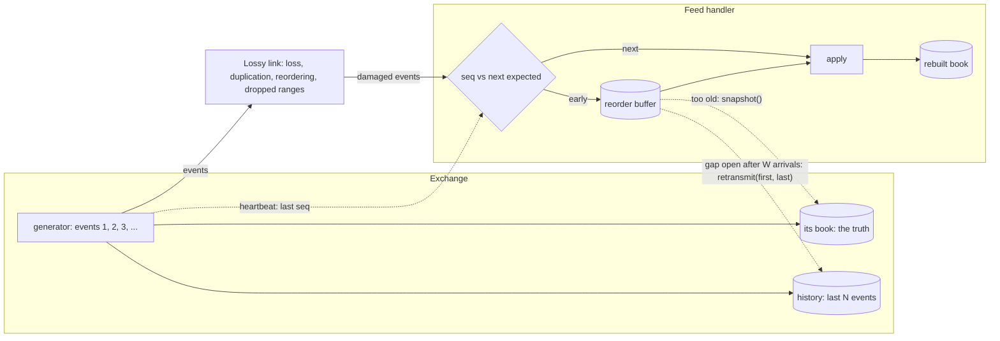
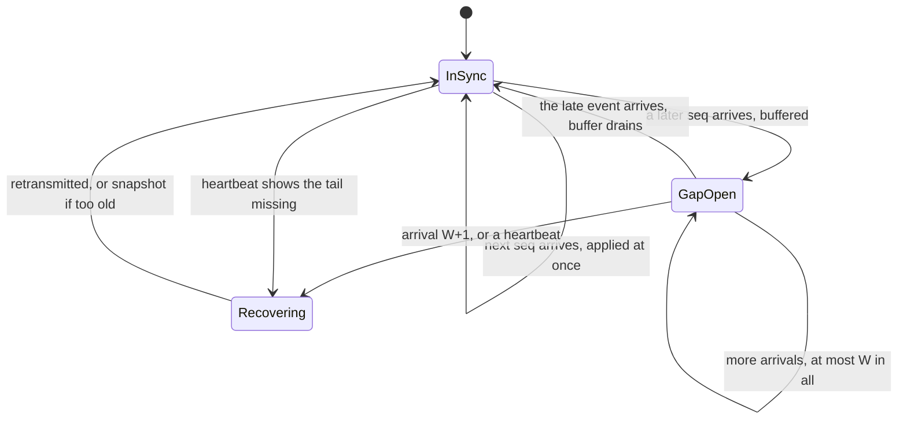

# Rebuilding an exchange's order book from a feed that loses events

Rohitangshu Bose (MT2025106), M.Tech CSE, IIIT Bangalore.
Distributed Computing, Programming Assignment 1. November 2026.
Code and documents: GNU GPL v3 or later.

## Summary

**The problem.** An exchange publishes every change to its order book as a numbered event. A trading
system rebuilds the book from those events, but on the way some are lost, some arrive twice and some
arrive out of order. A book rebuilt naively from such a stream is silently wrong, and a trading system
that acts on a wrong book acts on prices that do not exist.

**What the handler does.** It applies events strictly in sequence order, so its book is always the
exchange's book as of some sequence number: never wrong, at most behind. It holds early events in a
buffer, waits a few arrivals to tell a late event from a lost one, and recovers lost events by asking
the exchange to retransmit them, or, when they are too old for that, by taking a snapshot of the
exchange's whole book. A heartbeat from the exchange reveals loss at the end of the stream. Two
handler instances with unsynchronised clocks hand the stream over using Lamport timestamps.

**Results.**

- In every run, at every loss rate tried up to 50%, with duplication and reordering on top, the final
  book equals the exchange's exactly; in 200 random worlds per test run (5,000 in CI) it also equals the
  exchange's book as of its own sequence number after **every** arrival.
- On one core of a MacBook Air, the handler alone processes **20.4 M events a second** on a clean stream
  and **9.9 M at 20% loss** (49.0 ± 0.7 and 101.5 ± 4.2 ns per event, 95% confidence over 10 seeds). A
  typical arrival takes 83 ns; the p99 is 0.7 µs.
- Merged by physical time, the two instances' updates go out of order once the clock skew exceeds
  the handoff time; merged by Lamport time, never.

**How we know.** 110 tests trace to 16 written requirements: unit, structural, functional, property
and end-to-end tests. They cover 98% of the library's lines and 95% of its branches, catch all 16
deliberately planted bugs, run clean under AddressSanitizer and UndefinedBehaviorSanitizer, and pass
on x86-64 and aarch64 with GCC and Clang. Every result is seeded and reproducible.

## In plain words

A stock exchange keeps a list of everyone who wants to buy or sell, and at what price: the order book.
Every change to it goes out as a short numbered message, and banks and trading firms keep their own copy
of the book by applying the messages in order. The network that carries them is fast but careless:
messages go missing, arrive twice, or arrive out of order. A copy built from whatever arrives drifts
away from the exchange's without knowing it, and decisions taken on it are taken on prices that are not
there. The feed handler built here keeps the copy right. It applies messages strictly in number order,
waits briefly when one is missing in case it is only late, and otherwise asks the exchange to send it
again, or, if it is too old, for a copy of the whole book. Its copy is never wrong, only sometimes a few
messages behind.

The same problem, and the same remedies, appear wherever a copy of data is kept by replaying a stream of
changes: database replicas, shared documents, multiplayer games, phones syncing messages. And whenever
two machines hand work over, their clocks disagree; the project shows why ordering by clock time then
goes wrong and how Lamport timestamps avoid it.

## 1. The problem

### 1.1 Order books and market data

An **order** is an offer to buy (a **bid**) or sell (an **ask**) a quantity at a price. The
**order book** is every order resting at the exchange, grouped by price into **levels**. The highest
bid and the lowest ask are the **best bid** and **best ask**, the prices a trader can deal at now.

The exchange tells the world about its book with a **feed** of small **events**: an order is
**added**, **modified** (its quantity changes), **removed**, or **executed** (filled, partly or
wholly). Each event carries a **sequence number** (seq) one higher than the last. Anyone who applies
every event, in seq order, to an empty book holds an exact copy of the exchange's book.

### 1.2 What goes wrong on the way

Feeds are sent by UDP multicast because it is fast and reaches many receivers at once, and UDP
promises nothing (reference 2). So a receiver sees:

- **loss**: an event never arrives, one at a time or in bursts;
- **duplication**: an event arrives twice, for example when the same feed is sent on two lines for
  safety and both copies arrive;
- **reordering**: an event arrives after one numbered later;
- **loss at the tail**: the last events before a quiet period are lost, and nothing after them shows
  the gap;
- **late joining**: a receiver starts after the stream has begun.

### 1.3 Why a wrong book is worse than a late one

A book that is behind is safe if the system knows it is behind. A book that applied an event out of
order, missed an event or applied one twice can show a best bid that does not exist, and nothing in it
says so. So the requirement is not just to end with the right book: it is that the book is **never
wrong** in between.

### 1.4 The assignment

> Programming Assignment 1 asks students to implement a distributed market data feed handler. The
> implementation is expected to consume a sequenced event stream, perform order book reconstruction
> and detect and recover from artificially injected gaps. Students are encouraged to instrument their
> feed handler with Lamport timestamps when the assignment is extended to multiple, independently
> clocked feed handler instances, to make the ordering guarantees of the implementation explicit
> rather than incidental. (Reference 2, slide 28)

## 2. Requirements

Sixteen numbered requirements, each tested ([TESTING.md](TESTING.md)). In short: apply in-order
events at once (R1); drop duplicates (R2); buffer early events and absorb reordering without recovery
(R3); recover lost ranges by retransmission (R4), by snapshot when too old (R5), and find tail loss by
heartbeat (R6); **never show a wrong book, and end with the exchange's** (R7); under both recovery
policies (R8); order a handoff by Lamport time (R9); plus the exchange, book and link behaving as
specified (R10 to R12), checked command-line input (R13), correct statistics (R14), reproducibility on
every platform (R15) and memory safety (R16).

## 3. Design

### 3.1 Architecture

Everything runs in one process, so every run is deterministic and every failure can be replayed from
its seed. The **exchange** generates the stream from a seed, keeps its own book as the truth, keeps
its last N events for retransmission, and can snapshot its book. The **lossy link** damages the stream
at configured rates and can drop chosen seq ranges. The **feed handler** rebuilds the book. Recovery
requests go straight to the exchange, as they would over a separate reliable connection (TCP) in a
real system.



| Component | Source | Role | Lines of code |
| --- | --- | --- | ---: |
| Order book | `src/book` | applies the four event types; best bid and ask; fingerprint | 134 |
| Exchange | `src/exchange` | seeded generator, truth book, history, retransmit, snapshot | 120 |
| Lossy link | `src/network` | the damage, seeded | 96 |
| Feed handler | `src/handler` | sequencing, reorder buffer, recovery | 133 |
| Lamport | `src/lamport` | clocks, two instances, the handoff, log merging | 138 |
| Command line | `src/cli` | option parsing and checking | 253 |
| Statistics | `src/stats` | means, confidence intervals, paired t-tests | 123 |

### 3.2 The handler

The handler keeps one number, `next_seq`, the seq it needs next, and a buffer of early events keyed by
seq. For each arriving event:

```
if seq == next_seq and the buffer is empty:   apply it                      (the common case)
else if seq < next_seq or seq is buffered:    drop it, a duplicate
else:                                         buffer it, then apply buffered events while next_seq is there
    if the buffer is now empty:               the gap closed: it was only reordering
    else if this is the (W+1)th arrival since the gap opened:
        retransmit(next_seq, first buffered seq - 1)    one hole, or every hole in the buffer
        if the exchange no longer has that range: snapshot, then keep buffered events newer than it
heartbeat(last): if last >= next_seq, recover up to last
```

Because events are applied only in seq order, the handler's book is always exactly the exchange's
book after `next_seq - 1`. That is the safety property (R7), and the property tests check it after
every arrival.



### 3.3 Telling a late event from a lost one

A missing seq is usually late, not lost. Recovering at once would retransmit every reordered event;
never recovering would stall the book. The handler waits for **W further arrivals** (the reorder
window, default 3), counting arrivals rather than time, so the decision depends only on the stream and
is reproducible. On the link used here a reordered event arrives one place late, so any W of at least 1
absorbs all reordering, and `feed_demo reorder` shows 0 retransmissions. A larger W delays recovery
of real losses; the trade-off is measured in [PERFORMANCE.md](PERFORMANCE.md).

### 3.4 Recovery

- **Retransmission** of exactly the missing range, from the exchange's history of its last N events.
- **Snapshot** of the exchange's whole book when the range has left the history. The handler continues
  from the snapshot's seq and keeps buffered events newer than it.
- **Heartbeat**: when the stream goes quiet the exchange announces its last seq, which reveals loss
  that no later event could.
- **Policy**: when several holes wait behind the window, `every-hole` recovery fetches them all at once
  and `first-hole` only the oldest, the others waiting out windows of their own. `every-hole` is the
  default; the two are compared on the same seeds in [PERFORMANCE.md](PERFORMANCE.md).

### 3.5 Lamport timestamps across a handoff

Two instances with their own physical clocks, instance 0's running ahead by a chosen skew, share the
stream: instance 0 handles the first half, then sends a handoff message; instance 1 takes over from a
snapshot. Each logs its book updates with both its physical time and its Lamport time, and the logs are
merged afterwards. The handoff message carries instance 0's Lamport time L, and instance 1 sets its
clock to max(own, L) + 1 on receipt, so every update of instance 1 is stamped later than every update
of instance 0 (happens-before; Lamport, reference 3). Merged by physical time, the updates go
out of order once the skew exceeds the handoff latency; merged by (Lamport time, instance), never.

### 3.6 Reproducible by construction

Every run is fixed by its seed and settings. The random draws are written to be portable: the
standard distributions differ between C++ libraries, so the link compares raw bits of `mt19937_64` with
a threshold and the exchange takes remainders. A test pins the book after 100,000 events of seed 1, and
it passes on x86-64 (GCC 13, Clang 18) and aarch64 (GCC 11). A book **fingerprint**, a sum of
per-order hashes, lets the demo show that two books are the same as one number, and lets the property
tests compare the handler's book with the truth after every arrival.

## 4. Alternatives considered

| Alternative | Why not |
| --- | --- |
| Apply events as they arrive | One reordering leaves the book wrong, with nothing to show it |
| Recover the moment a gap appears (W = 0) | Retransmits every reordered event; measured in PERFORMANCE.md |
| Time out a gap after T microseconds | Depends on the machine's timing, so runs are not reproducible; counting arrivals is |
| Always resynchronise from a snapshot | Copies the whole book (about 200 orders) to recover one event |
| First-hole recovery | Later holes wait out a window each; kept as an option and compared |
| Physical timestamps for the handoff | Unsynchronised clocks misorder updates once skew passes the handoff time |
| Vector clocks | Give the full happens-before order, but two instances with one message need only Lamport time |
| Real sockets and processes | Timing makes failures irreproducible; the earlier networked design is kept, unbuilt, in `legacy/` |

Each decision, with its date and reasons, is in [decisions.md](decisions.md).

## 5. Implementation

C++20, one CMake project, no dependencies beyond the standard library (GoogleTest for the tests).
About 1,000 lines of library code, 1,200 in the two programs and 950 in the tests.

- **`feed_demo`** runs named scenarios, each showing one behaviour: `watch` (a live stream at 20%
  loss), `burst`, `reorder`, `tail`, `outage`, `random`, `lamport` and `all`. Run with no arguments, it
  asks which scenario to run and then each of its settings, with defaults; a bad answer is explained and
  asked again. Every setting is also an option (`--seed`, `--events`, `--loss`, `--dup`, `--reorder`,
  `--gap`, `--history`, `--window`, `--recovery` and more), checked before anything runs. Unless a seed
  is given, each run draws a fresh random one, prints it, and ends with the command that replays it
  exactly. `--show N` prints the first and last N events, each with what the link did to it and how it
  reached the book.
- **`feed_bench`** measures speed, per-call latency, book lag, correctness and the design choices,
  over many seeds, with confidence intervals, and compares two settings with a paired t-test.
- **Errors** are reported with what was wrong and what is accepted, and exit status 2:
  `feed_demo random --loss 150%` prints `--loss: "150%" is not a chance from 0 to 1; write it as 0.2
  or 20%`.
- **Documentation**: every class and function has a Javadoc-style comment; Doxygen builds them into an
  API reference with the test list (`doxygen`, then `docs/api/html/index.html`).

## 6. Verification

From [TESTING.md](TESTING.md):

| | |
| --- | --- |
| Requirements | 16, each traced to its tests |
| Tests | 110: 51 unit, 11 structural, 6 functional, 2 property (200 random worlds each run), 40 end to end |
| Coverage of the library | 98% of lines, 95% of branches; the rest are defensive checks only a bug can reach |
| Mutation check | 16 planted bugs, all caught |
| Sanitizers | clean under AddressSanitizer and UndefinedBehaviorSanitizer |
| Platforms | x86-64 with GCC 13 and Clang 18 (`-Werror`); aarch64 with GCC 11 |

## 7. Performance

Measured on a MacBook Air (Ubuntu VM, GCC 11, `-O3`), each figure a mean over 10 independent seeds
with its 95% confidence interval; the full tables are in [PERFORMANCE.md](PERFORMANCE.md).

| | |
| --- | --- |
| Handler alone, clean stream | 49.0 ± 0.7 ns per event (20.4 M/s) |
| Handler alone, 20% / 30% loss | 101.5 ± 4.2 / 110.1 ± 4.0 ns per event |
| Whole pipeline (exchange + link + handler) | 4.2 to 5.5 M events/s |
| One arrival, 5% loss: p50 / p99 / p99.9 | 83 / 680 ± 28 / 1,075 ± 515 ns |
| Book lag at 20% loss, p99 | 7 events |
| Correct final book, 0% to 50% loss and bursts | 10 of 10 seeds at every rate; 0 wrong in about 880,000 checks |
| Retransmission / snapshot | about 75 ns per event / about 12 µs for the whole book |

The design choices, compared on the same seeds with paired t-tests (all p < 0.0001):

- **Every-hole recovery** against first-hole at 20% loss: 29% less handler time (100.3 against 140.4
  ns per event) and book lag p99 7 events instead of 41. First-hole recovery forms a queue at
  utilisation loss × (window + 1), 0.8 at 20% loss, so holes wait behind each other.
- **Reorder window 3** against 0: 16,000 fewer needless retransmissions per million events, for 3
  events more lag at the p99. A window of 1 already removes 95% of them, because this link delays a
  reordered event by exactly one place.
- **Retransmission against snapshot**: the two cost the same near a gap of 120 events; beyond that a
  snapshot of this book is cheaper.

On a clean stream the book update is 99% of the handler's time (68.9 of 69.7 ns); sequencing costs
0.8 ns. Five earlier bottlenecks, found by profiling, are fixed (decision D35); what limits the
handler now is the book's data structures and recovery running inline.

## 8. Limitations and future work

- **One process, one channel.** Real feeds run over sockets and split the market into channels, each
  with its own sequence. The handler's logic is per channel and would not change; the earlier design in
  `legacy/` has the sockets.
- **Recovery is a function call.** A real retransmission request can be slow, lost or refused, and
  needs its own timeout and retry.
- **A simulated exchange.** The events are random but valid; real feeds (for example NASDAQ's ITCH over
  MoldUDP64) have more message types and binary encodings.
- **The reorder window counts arrivals.** On a quiet stream a gap waits until the heartbeat; a real
  handler would also bound the wait in time.
- **Lamport time orders, it does not detect concurrency.** L(a) < L(b) does not mean a happened before
  b; vector clocks would be needed for that, with more instances.

## 9. Reproducing the results

```bash
cmake -S . -B build && cmake --build build -j
ctest --test-dir build                                   # every test
./build/feed_demo all                                 # every scenario
./build/feed_bench all --csv results                  # every measurement, about 3 minutes
python3 tests/mutants.py                                 # the mutation check
```

## References

1. S. Rao, *Distributed Systems for High-Frequency Trading*, Lecture 1: Electronic Market Architecture
   and the Latency Problem, IIIT Bangalore, 30 September 2026.
2. S. Rao, *Distributed Systems for High-Frequency Trading*, Lecture 2: Market Data Distribution and
   Event Ordering, IIIT Bangalore, 5 October 2026.
3. L. Lamport, "Time, Clocks, and the Ordering of Events in a Distributed System", *Communications of
   the ACM* 21(7), 558-565, 1978.
4. H. Attiya and J. Welch, *Distributed Computing: Fundamentals, Simulations, and Advanced Topics*, 2nd
   ed., Wiley, 2004.
5. W. H. Press, S. A. Teukolsky, W. T. Vetterling and B. P. Flannery, *Numerical Recipes*, 3rd ed.,
   Cambridge University Press, 2007, section 6.4 (the incomplete beta function, used for Student's t).

## Appendix: use of AI

The assistant used, what it produced, and what was checked are recorded in [ai-use.md](ai-use.md).
